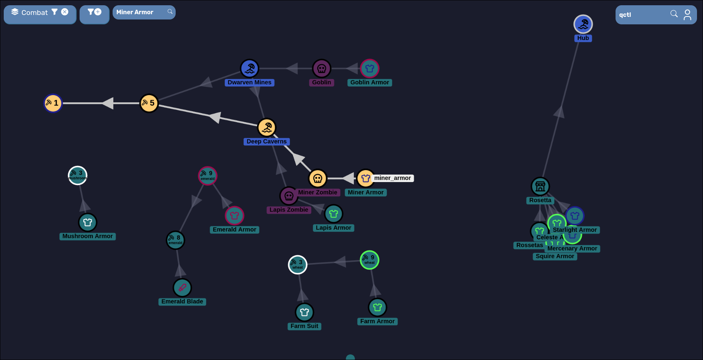

# SpringEngine

A lightweight JavaScript library for drawing **spring-based node graphs** on an HTML canvas, bundled with a web app that uses it to map the **wiki relations and progression of Hypixel SkyBlock**.

The library is general purpose: nodes are pulled toward the nodes they depend on, can be dragged around, and highlight their whole dependency chain on hover. The web app feeds it SkyBlock data (items, enemies, places, skills, collections) so you can see what leads to what.



> This project is a fan-made tool and is not affiliated with or endorsed by Hypixel Inc. nor Mojang.

## Features

- Canvas-rendered node graph with spring physics between connected nodes
- Drag nodes, or drag the background to pan the camera
- Hover a node to highlight it and everything it originates from (recursive focus)
- Search by name and jump the camera straight to a node
- Edge-of-screen indicators showing where off-screen nodes are
- Floating name tooltip for objects, enemies and places
- Node categories used by the SkyBlock data: `obj`, `emy`, `plc`, `att` (skills), `col` (collections)
- Name lookup tables built automatically as nodes are added (prefixes like `enemy_`, `shop_`, `place_`, `attr_` are stripped)

## Requirements

- Python 3.9+
- Node.js 18+ (only needed for building or linting the JS library)
- `make` (optional, but recommended)

## Quick start

```bash
git clone https://github.com/Lossymandias/g-SpringyJS-SkyProgress
cd g-SpringyJS-SkyProgress

make install   # creates .venv and installs Python + JS dependencies
make run       # starts the web app via main.py
```

Then open <http://127.0.0.1:5000>.

Without `make`:

```bash
python3 -m venv .venv
source .venv/bin/activate
pip install -r requirements.txt
python main.py
```

The host and port can be changed with environment variables, for example `make run PORT=9000`.

### Configuration and secrets

The application uses a local secrets file to store private configuration values, such as API keys.

Before starting the application, create your local secrets file:

```bash
cp local_secrets.example.py local_secrets.py
```

Open `local_secrets.py` and replace the placeholder values with your own credentials:

```python
API_KEY = "YOUR_API_KEY_HERE"
```

**Important:**
- `local_secrets.py` is excluded from Git and must never be committed.
- `local_secrets.example.py` is tracked and contains placeholders only.
- Each developer must create their own `local_secrets.py`.
- If you accidentally expose a real API key, revoke or rotate it.

The application imports these values automatically when it starts.

## Make targets

| Target            | Description                                                   |
|-------------------|---------------------------------------------------------------|
| `make help`       | List all targets                                              |
| `make install`    | Create the virtualenv and install dependencies                |
| `make run`        | Run the web app (`main.py`)                                   |
| `make dev`        | Run the web app with debug / reload enabled                   |
| `make build`      | Bundle the library into `dist/` (ESM and minified IIFE)       |
| `make lint`       | Lint Python (ruff) and JavaScript (eslint)                    |
| `make format`     | Auto-format Python code                                       |
| `make data-check` | Validate the JSON files in `data/`                            |
| `make clean`      | Remove build artifacts and caches                             |
| `make distclean`  | `clean`, plus remove `.venv` and `node_modules`               |

## Project layout

```
.
├── main.py            # Entry point for the web app
├── src/               # SpringEngine library (JavaScript)
├── data/              # SkyBlock wiki relations and progression data
├── scripts/           # Data update helpers (e.g. update_wiki.py)
├── docs/images/       # Screenshots used in this README
├── dist/              # Built library (generated)
├── Makefile
└── README.md
```

Adjust this to match your actual structure.

## Using the library

The engine expects a canvas with the id `myCanvas`.

```html
<canvas id="myCanvas"></canvas>
<script type="module">
  import { SpringEngine } from './dist/spring-engine.js';

  const engine = new SpringEngine();
  engine.resizeCanvas();
</script>
```

### Adding nodes and connections

Each element passed to `addElem` is a plain object describing a node:

```js
engine.addElem(0, {
  com_id: 0,                 // unique index of the node
  com_name: 'enemy_zombie',  // raw name (prefixes are stripped for display and search)
  com_specific: 'emy',       // category: obj | emy | plc | att | col
});

engine.addElem(1, {
  com_id: 1,
  com_name: 'zombie_sword',
  com_specific: 'obj',
});

// Link node 1 to the nodes it comes from (here: node 0)
engine.connectElem([0], { com_id: 1 });
```

- The first argument of `addElem` is the **layer**. Nodes are placed in columns by layer, which gives the progression its left-to-right flow.
- `att` nodes also take `att_value`, and `col` nodes take `col_value`.
- `connectElem(refIndices, elem)` links a node to the nodes it originates from.

### Render loop and input

```js
function frame() {
  engine.updateTotal(engine._seLlTotalNode);
  engine.drawTotal(engine._seLlTotalNode);
  requestAnimationFrame(frame);
}
frame();

canvas.addEventListener('mousemove', e => engine.hoverPiece(e.clientX, e.clientY));
canvas.addEventListener('mousedown', e => engine.eventStartDrag(e.clientX, e.clientY));
canvas.addEventListener('mouseup',   () => engine.eventEndDrag());
canvas.addEventListener('mousemove', e => engine.eventDrag(e.clientX, e.clientY));
```

### Searching

```js
engine.setPosNodeByName('zombie sword');  // centers the camera and highlights the chain
```

## SkyBlock data

The web app uses the data in `data/` to build the graph: which items come from which enemies, which places unlock which content, and how skills and collections gate progression.

To refresh it:

```bash
make wiki
make data-check
```

Data is derived from publicly available SkyBlock information. Please be considerate of the source's terms and rate limits when updating it.

## Contributing

1. Fork the repo and create a feature branch.
2. Run `make lint` and `make test` before opening a pull request.
3. Describe what changed and why. Screenshots help for visual changes.

## License

Add your license here (for example MIT) and include a `LICENSE` file in the repo root.